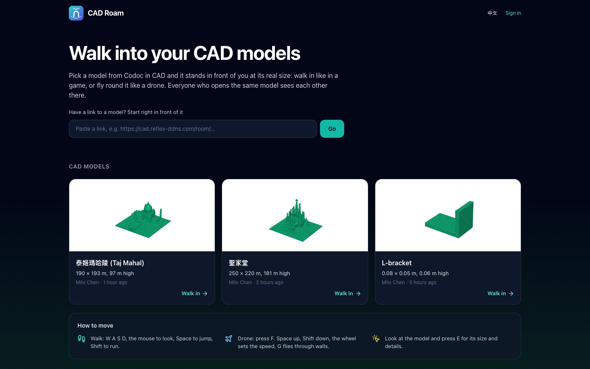
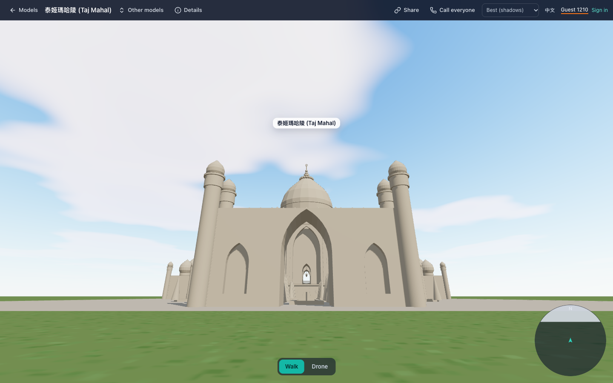
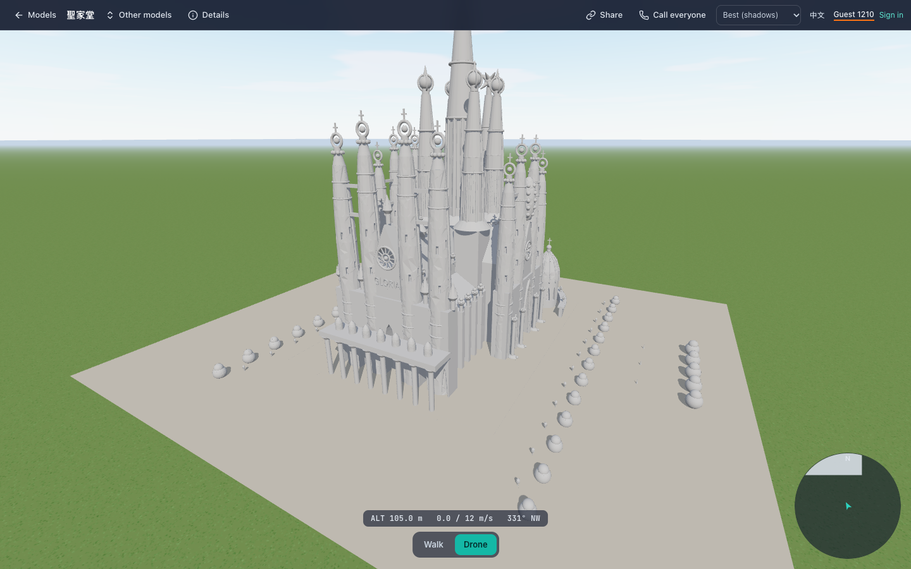
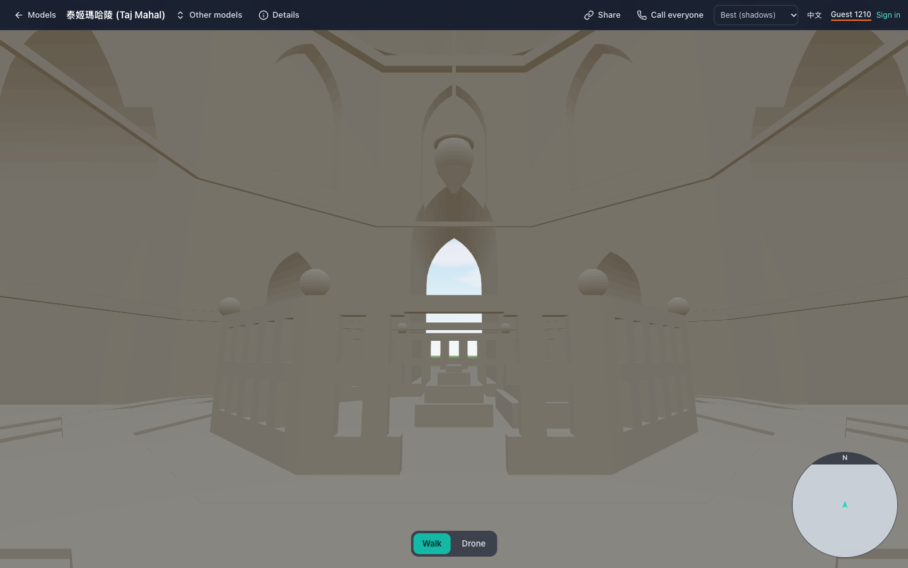
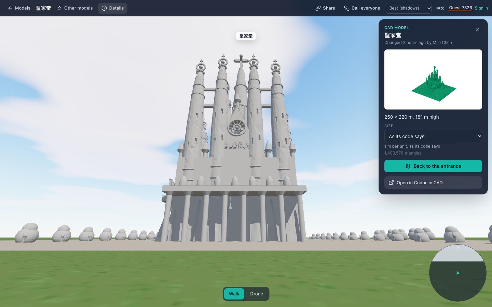
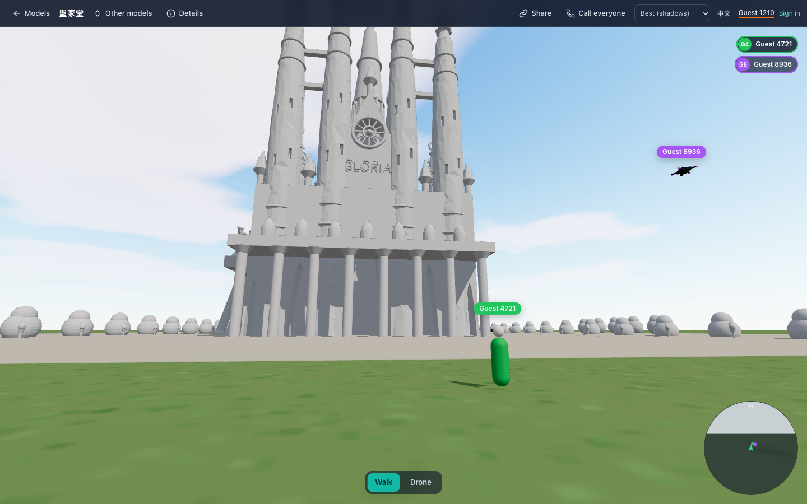

# CAD Roam 🧭

Walk **into** your CAD models. Pick a model made in [Codoc in CAD](https://github.com/milochen0418/codoc_in_cad) and it stands in front of you at its **real size**, in its colours: walk in like in a first-person game (in through the Taj Mahal's gate, up to its tomb chamber), or fly round it like a drone (over the Sagrada Família's towers). Its glass is glass: in the morning sun the Sagrada Família's blue and green windows glow and throw their colours on the floor and the pillars, in the evening its red and orange ones. And its inside is lit as an inside is: by the daylight coming in through its openings and windows, by its lamps, and by the light its floors, walls and vaults throw back, with your eyes getting used to it as you step in. Everyone who opens the same model sees each other there, walking or flying, and can call everyone.

Built with [Reflex](https://reflex.dev/) and [three.js](https://threejs.org/) for the [re-ddns](https://github.com/milochen0418/re_ddns) Agentic App Store: install it there and open `https://cad-roam.reflex-ddns.com`. A model's address is the same as in Codoc in CAD, with another app name: `https://cad.reflex-ddns.com/room/e5172e80e3` is edited there and walked in at `https://cad-roam.reflex-ddns.com/room/e5172e80e3`. It also runs on its own.

## 📸 Interface Preview

| The models, at their real size | Arriving at a model |
|:---:|:---:|
|  |  |

| Flying the drone | Walking inside |
|:---:|:---:|
|  |  |

| The model's details (its real size) | Others at the model, walking and flying |
|:---:|:---:|
|  |  |

## 🌟 Features

**Pick a model, go in**
- The first page lists the models of the shared collection `cad-models` (Codoc in CAD's models, and STL files imported on the App Store's storage page): the picture of each one's last build, its real size, who changed it and when, and who is in it now. A model that never built says so.
- **Paste a link** to start right in front of a model: its room in Codoc in CAD (`https://cad.reflex-ddns.com/room/<id>`), a CAD Roam link, a ref (`cad-models:cad/<id>`) or just the id.
- **Other models** in the top bar switches without going back; the App Store's storage page offers **Open with → Walk in CAD Roam** for every CAD model.

**Two ways to move** (press **F** to switch)
- **Walk** like in a game: W A S D (or the arrows) to move, the mouse to look (click the view; Esc frees the mouse, or drag to look without it), Space to jump, Shift to run. Walls stop you, stairs and kerbs are stepped up (up to 36 cm), and you fall off ledges.
- **Drone**: Space up, Shift (or Q) down, the wheel sets its top speed (1 to 160 m/s). It drifts a little and leans into turns like a real drone, bumps into the model, and with **G** flies through walls (ghost). It shows its height above whatever is below it, its speed and its heading.
- **Through your eyes, or from behind** (press **V**, or **Eyes** / **Behind** beside Walk / Drone): see the place through your own eyes, or see yourself from a little behind and above (4 m behind you walking, 2 m behind your drone), as the others see you: your figure in your colour, or your drone leaning into its turns. From behind it is easier to steer, and to see where you are among the others. The camera stays on your side of walls, floors, ceilings and glass: it comes closer where something is behind you (with your back against a wall it is just over your head, and your figure isn't drawn), and a ghost drone's camera goes through walls with it. Your browser keeps the choice.
- **L** lights a torch for dark insides (the others see its light too), **T** jumps the sun to the morning, the day or the evening (the ☀ slider under Walk / Drone moves it through the day, for everyone at the model), **E** (or a click while looking) opens the model's details, **H** shows the keys again. Phones and tablets get a stick and up/down buttons; a gamepad works too (sticks, A up, B down, Y walk / drone, View (Back) eyes / behind).

**In its colours**
- A model built in Codoc in CAD since it has colours shows each part in its colour: the build writes a GLB beside the STL, and CAD Roam draws that. Models built before, and STL files imported on the storage page, are drawn in one stone colour (press Run in Codoc in CAD to get the colours).
- See-through parts (a colour with an alpha, like `("#2f6fd6", 0.55)`) are glass. From inside, a stained-glass window shows the sky in its colour and glows when the sun is behind it; the sunlight that comes through it falls in its colour on whatever it reaches, its pattern cut by the stone round it.
- **Lamps glow, and light what is round them.** A part that gives light (in Codoc in CAD, `lamp.glow = True`: lamps, candles, screens, stars) is drawn in its own colour as it is, unshaded, by day and in the dark of an inside, and its light falls on what is round it in its colour: the vault round a church's lamps, the roof over a chapel's lamp, the pillars beside them; the brighter its glow, the more light. By day, wherever daylight gets in, the daylight is most of the light, as with real lamps.
- **Big models ask first.** A model in its colours with more triangles than `CAD_ROAM_MAX_TRIANGLES` (3 million) loads only once you say so: a question tells how many triangles it has (and how many times the limit), how much it downloads and about how much memory it takes, its light inside too (the Sagrada Família at 4.7 million: 9.3 MB, about 1.2 GB with *Best*). **Load it** draws it in its colours; **Don't load** leaves its outline, with **Load it** at the top left for later. The answer holds while the page is open, for the model's next builds too; a new page asks again.
- **The sun's time**: drag the ☀ slider under Walk / Drone from 6:30 to 17:30, and the sun crosses the sky as it does on a spring or autumn day at Barcelona's latitude: up in the east, 49° high in the south at noon, down in the west, warmer and with a dimmer sky when it is low. **T** jumps to 7:30, 10:30 and 16:30. 10:30 is where you arrive: the sun behind you, a little to the east (+X is east, the front of a model faces south). The time is the model's, the same for everyone at it (see *Together*); your browser keeps the time you leave it at, and brings it when nobody else is at the model. The Sagrada Família's Nativity side (+X) has the cool windows, lit in the morning, its Passion side the warm ones, lit in the afternoon, as in the real church.
- **The light inside.** Inside a building, the light is what really gets in: the sky's through its doors, openings and windows (in the colours of their glass), the sun's through them (in patches), the light of its lamps, and the light its floors, walls and vaults throw back, which fills an inside more than the rest. So the Sagrada Família's nave is lit from its windows and its lamp-filled vault, its floor a little less, its side aisles in the colour of their windows; a closed room is dark but for its lamps. Outside, what the sun doesn't reach (a wall facing away from it, a street, a courtyard in a building's shadow) is lit by the sky it sees and the walls round it, as on a real day: a wall in the shade about as bright as a wall out in the open, a courtyard between tall walls less (it sees less of the sky), none dark as at night. It is worked out when the model loads and again when the sun moves (about two seconds for the Sagrada Família on an M4 Mac, the picture keeps its speed meanwhile), and comes in smoothly.
- **Eyes used to the dark.** Inside, the view gets brighter, up to ten times, as eyes (or a camera) get used to less light: an inside looks as bright as it does to someone standing in it, and its windows and the sunlit patches shine. Step out and it is as before. These lights need *Best (shadows)*; *Fast* shows the colours and the glass only, lit by the sky everywhere.

**Real size**
- A model's code says what one unit is, in a comment CAD Roam reads: `# 1 unit = 0.5 m`, `# 單位：1 = 1 公尺`, `# units: mm`. Without one it is in millimetres (build123d's unit). **Details** shows its size in metres and where that size comes from, and lets anyone choose another unit for everyone. Models under 1.5 m stand on a pedestal.

**Live**
- When someone presses Run in Codoc in CAD, everyone at the model sees the new build within a couple of seconds. The rebuilt model swaps in once its new mesh has loaded, so you can stand inside a building while it is being changed. A model that had never built appears the moment it does, with you in front of it.

**Together** (the same rules as the other apps)
- Everyone at a model sees the others: a figure in their colour when they walk, a little drone with their colours when they fly, their name over them, a chip for each at the top right (a click takes you to them) and their dot on the map.
- **One sun for everyone.** The sun's time is the model's: whoever drags the ☀ slider (or presses T) moves the sun for everyone there, the light inside with it, and a note tells the others who moved it and to when. Someone coming in gets the model's time.
- **Torches the others see.** Someone's torch (L) shines from them for everyone: its lamp glows on their head (or under their drone), a soft beam goes out where they look, and its light falls on the model as it does for them, stopped by walls, pillars and floors (with *Best (shadows)*; with *Fast* it goes through them). The three torches nearest to you light the model; the others' lamps still glow.
- **Profiles.** The round button beside someone's chip opens their profile, and your own name at the top opens yours: Relack's User Profile, in a dialog over the model (for people signed in; a guest has none).
- **Call everyone** rings everyone at the model through an installed call app (DDNS Intent `call.join`), as on a Codoc in CAD model.
- Signed in (the platform's account), you show as yourself; otherwise as a guest.

**An AI looks inside** (through the AI Hub)
- An AI working on a model (Claude Code in Codoc in CAD's AI assistant, say) can look at it from inside, as people walking in it see it: `roam.view` takes a picture from a place it names in the model's own coordinates (as its code has them), looking at a point or along a compass bearing, at a time of the day; `roam.tour` takes pictures from several places in one go; `roam.where` tells where the people in CAD Roam stand and look. With each picture come the light where the eyes are against the open sky's, how much the view is brightened there, how bright the picture is and how far the first wall ahead is. So it can walk through a building, find where it is too dark, change the code in Codoc in CAD, build it and look again.
- The pictures are taken by a CAD Roam page open on the model (a browser draws them, with its graphics card): any tab, also one in the background, those drawing with *Best (shadows)* first. Its person keeps their own view; for a moment their light follows the picture's time of day, and a note says an AI took a picture. With nobody on the model, the AI is told which page to ask for.

## 📐 How it works

```
  browser                                            CAD Roam's backend (Reflex + Starlette)
  ┌──────────────────────────────────┐   GET  /_roam/world/<owner>/<id> ┌────────────────────────────┐
  │ assets/roam/  (three.js)         │ ──────────────────────────────▶ │ models.py: the model, its  │
  │  engine.js  scene, sky, loading  │   GET  /_roam/mesh/…?v=…         │   real size, revisions     │
  │  player.js  walk / drone physics │ ──────────────────────────────▶ │ meshes.py: STL → indexed   │
  │  things.js  the model            │                                   │   mesh, or the GLB (gz)    │
  │  look.js    colours, glass, sun  │                                   │                            │
  │  view.js    eyes or from behind  │                                   │                            │
  │  people.js  the others           │ ◀──── WS /_roam/ws/<owner>/<id> ▶ │ presence.py: who, where    │
  │  hud.js     keys, map, chips     │   poses ~10/s, "model changed"    │ api.py: watches the models │
  └──────────────────────────────────┘                                   └─────────────┬──────────────┘
        Reflex pages around it: the list, the switcher, the details, calls             │ reads (read-only)
                                                                                        ▼
                                          /data/collections/cad-models/by-app/cad/<id>/   (re-ddns mounts)
```

- **Meshes.** A model is drawn from the GLB its build wrote beside the STL (Codoc in CAD's `model.glb`, each part in its colour), sent gzipped as it is (the Sagrada Família's: 50 MB, 6.4 MB gzipped, 2.3 million triangles); three.js reads it and makes one mesh per colour. Without a GLB, from the STL, which writes every corner of every triangle out (70 MB for an older Sagrada Família, 1.4 million triangles): `cad_roam/meshes.py` sends each corner once and the triangles as indices, gzipped (9 MB). Either is made once per build and cached in `CAD_ROAM_HOME` under the file's size and time, so a rebuilt model gets a new URL and browsers cache the rest for good. STLs over `CAD_ROAM_MAX_TRIANGLES` (3 million) are simplified first; a GLB over it is sent as it is once the person agrees (the place says `big`: the limit and the gzipped size, so the browser can ask), and one that needs a glTF extension isn't used (the STL is).
- **Glass and light** (`assets/roam/look.js`). A part whose colour has an alpha is drawn twice after the rest: once multiplying what is behind it by its colour, once adding its reflections and the sun shining through it. Each frame the glass is also drawn from the sun into a small picture of its colours and depth; surfaces look it up next to their shadow, and those behind glass from the sun get its colour.
- **The light inside** (`assets/roam/light.js`). When a model loads, its surfaces are added up in a grid of cells over it (about a million; 2.2 m across for the Sagrada Família): how much of each cell they block along each axis (4 x 4 lines through it), their colour, the light they give, the glass. On the GPU, first and once for a model (the sun doesn't change it), every cell works out the sky it sees, along 64 directions over the sky, through the glass on the way. Then every cell gathers the rest of the light coming to it along 16 cones (cone tracing through coarser and coarser grids): the light of lamps; the light thrown back by what it meets, sunlit (from a picture of the model and its glass seen from the sun) or lit by the round before; the ground's where a cone gets out under the model. What stops the light is read a block at a time, in blocks blended with the ones round them and kept clear of the cell the light comes to (the grids' coarse blocks don't move with it, and one holding the wall or the floor beside that cell stopped the light from the other side: a wall in the shade, a courtyard or a street got half its light, or less, and looked as at night), and a coarse block lets through the lines along it that none of its cells blocks (a pergola's ribs, one behind the other, stop only what one of them covers). Four rounds, a few layers of cells a frame, add the light thrown back again and again; the result (a colour and how much more comes from each side) lights every surface instead of the sky's light, and a probe at your eye tells how much to brighten the view. It needs WebGL 2 with float render targets, as every browser with a GPU has.
- **Collisions** use [three-mesh-bvh](https://github.com/gkjohnson/three-mesh-bvh): the model gets a bounding-volume tree when it loads; the walker is a capsule, the drone a sphere. three.js and three-mesh-bvh are npm packages bundled by Reflex's Vite (`lib_dependencies`), so nothing comes from a CDN at run time.
- **From behind** (`assets/roam/view.js`). The camera goes back from a point above your eyes, the way you look; a ray through the same bounding-volume trees finds the first thing in the way (another one straight up, a low ceiling), and the camera stops 25 cm short of it, at once, then goes back out smoothly when the way is clear. The torch shines from you, not from the camera. Your figure is the one the others see of you (`people.js`).
- **Coordinates.** A model's Z is up and its front is -Y (Codoc in CAD's "Front" view); you arrive facing its front, and it stands on the ground at its own z = 0, scaled by its unit.
- **Presence.** A tab enters a model's place from its Reflex page (so the person comes from the sign-in, not from the browser), then its 3D view opens the model's socket with the tab's id and Reflex token; poses go out about ten times a second while you move, with whether your torch is on. A closed tab leaves at once. The sun's time goes through the server too: the first one at a model brings theirs, and each move of it is numbered and sent to everyone, the one who moved it too, so two people dragging it at the same moment both end at the move the server took last.
- **The others' torches** (`assets/roam/people.js`). Each figure carries a lamp, its glow and a beam (a cone of light in the air, shortened where a wall is nearer); the three nearest torches that are on are spot lights, always there and off when unused (a light more or less would compile every surface's shader again), each with its own shadows. What casts shadows is drawn into them in plain depth (`look.js` `FLAT_DEPTH`): three.js would draw a spot light's shadows in the renderer's logarithmic depth, and every surface would then be in its own shadow.
- **Pictures for an AI** (`cad_roam/ai_tools.py`, `cad_roam/eyes.py`, `assets/roam/eyes.js`). The tools turn the AI's place (the model's coordinates) into the view's, and ask the best tab on the model for a picture over its people socket. The tab loads the newest build if it hasn't, works out the light for that time at once (a tab in the background draws no frames, so nothing waits for one), draws the view on its own canvas at 1280 x 800 and reads it back in the same moment, so its own view never shows it, and sends a JPEG back.
- **Watching.** Every 2 s the backend stats the manifests of the models people are in; a change rebuilds the place and tells everyone in it to fetch it again. The place's version changes only when something that shows changed, so typing in Codoc in CAD (which saves the code every 1.5 s) doesn't make anyone reload.

## 🚀 Install on re-ddns (Agentic App Store)

CAD Roam is in the App Store catalog as `cad-roam`. Its entry gives it **read** access to the collection `cad-models`, mounted read-only: CAD Roam never writes a model. Its own data (meshes, the sizes people chose) is in the volume `smart-app-cad-roam-data`. `backend-paths.txt` sends `/_roam/` to the backend.

## 💻 Run locally

```bash
poetry env use python3.11
poetry install
poetry run ./reflex_rerun.sh
```

Open `http://localhost:3000`. On a Mac it reads the same shared folder the local apps write (`/Users/Shared/re-ddns/collections`); `DDNS_COLLECTIONS_ROOT` points it elsewhere. If ports 3000/8000 are taken: `REFLEX_API_URL=http://localhost:8150 poetry run reflex run --frontend-port 3150 --backend-port 8150`.

## ⚙️ Configuration (all optional)

| Variable | Default | Meaning |
|---|---|---|
| `CAD_ROAM_HOME` | `~/Library/Application Support/cad_roam` (macOS), `~/.local/share/cad_roam` | Meshes made from models, and the sizes people chose |
| `CAD_ROAM_MAX_TRIANGLES` | `3000000` | A model in its colours with more triangles asks before it loads; a bigger STL is simplified to this many |
| `CAD_ROAM_CALL_APP` | (chosen when calling) | The call app every call uses |
| `DDNS_COLLECTIONS_ROOT` | set by re-ddns | Where the collections are |

## 🧪 Tests

```bash
poetry run pytest                              # 51 unit tests: units, meshes and GLBs, models, links, presence, routes, an AI's pictures
poetry run ./run_test_suite.sh smoke_home      # E2E (Playwright), see testcases/README.md
```

The E2E suites build their own small `cad-models` collection (`testcases/fixtures.py`: a house with a door and stairs, a tower, a small part, a model that never built, a chapel in its colours with a blue window) and never see your models.

## 🩺 Troubleshooting

- **A model is tiny or huge.** Details says what size CAD Roam uses and why; choose one, or add `# 1 unit = 1 m` to its code.
- **"Not built yet".** The model has no STL: open it in Codoc in CAD and press Run.
- **All one colour.** It was last built before Codoc in CAD wrote colours: press Run there once.
- **Only an outline, "not loaded".** The model is big and you chose *Don't load*: press **Load it** at the top left, or open the page again.
- **No light through the windows.** Move the sun (the ☀ slider, or T) to where the windows face: the east ones in the morning, the west ones in the afternoon. At 10:30 it is high in the south-east. And choose *Best (shadows)*.
- **An inside is lit flat for a moment.** Its light is still being worked out after the model loads or the sun moves; it comes in within a couple of seconds (longer on a computer without a GPU).
- **Slow.** Pick *Fast (no shadows)* in the top bar. Browsers without a GPU draw 3D in software.
- **The sun moved by itself.** Someone else at the model moved it: a note says who. The time is the same for everyone there.
- **The mouse doesn't turn the view.** Click the view once (Esc gives the mouse back), or drag.
- **From behind, the camera jumps in close.** Something is behind you (a wall, a pillar, a low ceiling): it goes back out once there is room. In tight places, V for your eyes.

## 📄 License

MIT
